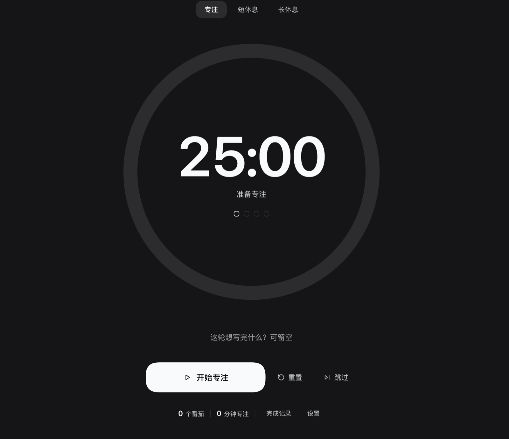

# dsh-pomodoro

English · [简体中文](README.zh.md)


> A distraction-free Pomodoro timer in the DSH sidebar — focus, short-break and long-break rounds with a per-round goal, today's stats and completion log, and a countdown that keeps running while you work in other panels.



The panel *is* the timer: one large progress ring and a big countdown, with modes, goal and controls pushed to a secondary level. Switching to a conversation or another panel never pauses the countdown, and a round that ends while you are elsewhere announces itself with a frame-wide toast and an optional chime.

## Features

- **Sidebar entry.** Registers a `sidebar.panellist` row (`pomodoro`, order `21`) directly below the **Writing** (`写作`) entry when [dsh-book](https://github.com/ChenYichener/dsh-book) is installed, otherwise after the shell's own entries. The icon shows a green badge while a round is running.
- **Distraction-free page.** No cards, no borders: a large progress ring (up to 560 px), a 112 px tabular countdown, three quiet mode tabs, one goal input and the controls. Everything else lives in two collapsible panes.
- **Three modes.** Focus / short break / long break with defaults of 25 / 5 / 15 minutes; every *N* completed pomodoros (default 4) earns a long break. All durations and *N* are editable in Settings.
- **Per-round goal.** One line of up to 120 characters — "what will you finish this round?" — stored with each completed pomodoro and shown in the completion log.
- **Start / pause / resume / reset / skip.** The primary button's label follows the state; Reset restores the full duration of the current mode; Skip jumps focus → short break, or a break → focus.
- **Today's stats.** The footer shows today's pomodoro count and total focus minutes; the completion log lists each round as time + goal + minutes, with a two-click clear.
- **Timer survives panel switches.** The countdown is owned by a module-level store, not by the mounted page, so navigating to a conversation or another panel keeps it running and re-opening the panel restores it.
- **Frame-wide completion notice.** The toast registers in `shell.overlay`, so "Pomodoro complete — take a 5-minute break" is visible from any panel for six seconds, alongside a soft two-tone chime (switchable).
- **Persistence and daily rollover.** Settings, today's log and the running countdown are saved to `localStorage`; a round that expired while the page was closed is completed the next time the page opens, and daily stats roll over at local midnight.
- **Theme-aware and localized.** Every color comes from the host's `--dsw-alias-*` theme tokens (light/dark just work), and Chinese/English copy is registered through the Client locale service.

## Install

> Prerequisite: [DeepSeek Harness](https://github.com/deepseek-ai/deepseek-harness) (`dsh`) with the Web UI, and Node.js >= 20 on the machine that runs it.

### From GitHub (recommended)

```bash
dsh plugin --profile <profile> add github:ChenYichener/dsh-pomodoro
```

### From a local clone

```bash
git clone https://github.com/ChenYichener/dsh-pomodoro.git
dsh plugin --profile <profile> add /path/to/dsh-pomodoro
```

### DSH desktop app

Open the app's **Plugins** page and install the plugin from a local directory. This plugin is a regular profile bundle, so it survives `dsh` restarts and upgrades.

After installing, restart `dsh web` (or reload the DSH window) and the **Pomodoro** row appears in the sidebar. The default profile is usually `web` (the one `dsh web` uses); run `dsh plugin --profile web list` if you are unsure.

### Requirements

| Requirement | Value |
| --- | --- |
| DSH | Tested with `0.2.2-rc.1`; needs the Web UI and its Client plugin API |
| Node.js | `>= 20` |
| Runtime dependencies | None |
| Build step | None — plain ES modules loaded by the DSH module loader |

## Usage

Open the **Pomodoro** entry in the sidebar. The shell selects `main.pomodoro`, which is the full-page timer.

| Action | How | Behaviour |
| --- | --- | --- |
| Start | Primary button (`Start focus` / `Start break`) | Starts or resumes the current mode's countdown |
| Pause / resume | Same primary button (`Pause` / `Resume`) | Pause freezes the remaining time; resume continues from it |
| Reset | ⟲ button | Stops the timer and restores the full duration of the current mode; today's stats are untouched |
| Skip | ⏭ button | Focus → short break, or short/long break → focus. A skipped focus round does **not** count as a pomodoro |
| Pick a mode | The three tabs above the ring | Stops the timer and loads that mode's full duration |
| Set the goal | Text input under the ring | Saved with the next completed pomodoro; stays for following rounds until you edit it |
| Change settings | Footer → **Settings** | Steppers per setting; changing the duration of the current idle mode updates the countdown immediately |
| View the log | Footer → **Completed** | Today's rounds, newest first: time, goal (or "Writing focus"), minutes |
| Clear today | **Completed** → **Clear** → confirm | Drops today's pomodoros, focus time and log; also resets the round progress |

There are no global keyboard shortcuts — the page is deliberately click-first and quiet. The countdown keeps running while you use other panels; a green badge on the sidebar icon shows that a round is in progress.

## Settings

Settings live in the footer pane and are persisted with the rest of the state.

| Setting | Default | Range | Step |
| --- | --- | --- | --- |
| Focus length | 25 min | 5–90 min | 5 min |
| Short break | 5 min | 1–30 min | 1 min |
| Long break | 15 min | 5–60 min | 5 min |
| Long break every | 4 pomodoros | 2–8 pomodoros | 1 |
| Completion chime | On | On / Off | — |

Changing a duration while that mode is idle immediately updates the visible countdown; changing the long-break interval clamps the current round progress to the new interval.

## How it works

- **Sidebar row.** The client registers `sidebar.panellist` with id `pomodoro`, `order: 21` and a locale-bound `label`. The shell owns the button and selects `main.pomodoro` when it is clicked; the icon component subscribes to `snapshot.running` and adds a badge while running.
- **Main page.** The same client registers the `main` slot keyed `pomodoro`. The page is a plain React component that reads the store through `useSyncExternalStore`.
- **Timer store.** `createPomodoroStore()` is created once in `apply()`, outside React. It owns the state object, persists the durable subset on every change, and notifies subscribers. Because the timer is not component state, unmounting the page (switching panels) never stops it.
- **Clock.** While running, a 250 ms interval refreshes `now`; the remaining time is derived from the absolute `endsAt` timestamp, so the countdown stays correct even if the timer is throttled in a background tab. A separate 30 s interval rolls the daily stats over when the local date changes.
- **Phase transitions.** When `now >= endsAt` in focus mode the round is counted (`today.count + 1`, `focusMs += focus length`, a log entry is prepended, capped at 50 entries) and the cycle advances. Reaching the configured *N* opens a long break, otherwise a short break. When a break ends the timer returns to focus and, after a long break, resets the cycle to 0. Only completed focus rounds increment the cycle — Skip does not.
- **Completion notice.** The store pushes a transient `notice` object; the `shell.overlay` slot renders it as a `role="status"` toast for six seconds. The chime is two short sine tones created with WebAudio on the first Start, so the browser's user-gesture requirement is already satisfied.
- **Styling.** One `<style data-plugin="dsh-pomodoro">` element is owned by the plugin fiber; all colors reference `--dsw-alias-*` tokens, so the page follows the host's light/dark theme.
- **Localization.** Both dictionaries are registered under the `dsh-pomodoro` locale namespace; `useTranslate` re-renders when the locale revision changes, falling back to the bundled Chinese table if the service is unavailable.

## Data & privacy

Everything stays in the browser. There is no network request, no host route, no host state, and no telemetry.

State is stored in `localStorage` under the key `dsh-pomodoro/state/v1`:

```json
{
  "version": 1,
  "mode": "focus",
  "running": false,
  "endsAt": null,
  "remainingMs": 1500000,
  "cycle": 2,
  "goal": "Finish the introduction to section 3",
  "today": {
    "date": "2026-11-03",
    "count": 2,
    "focusMs": 3000000,
    "log": [
      { "at": 1762137600000, "minutes": 25, "goal": "Finish the introduction to section 3" }
    ]
  },
  "settings": { "focus": 25, "short": 5, "long": 15, "cycle": 4, "sound": true }
}
```

- `endsAt` is written only while running; `now` and the transient `notice` are never persisted.
- `today` is the local calendar day; a stored block for another date is discarded on load and at the next rollover check.
- Clearing the browser's site data removes the timer, settings and history — nothing is backed up elsewhere.

## Development

There is no build step. `index.js` and `client.js` are plain ES modules; `client.js` registers itself through `window.__ModuleLoader__` and resolves `react` from the host module table.

```bash
node --check index.js
node --check client.js
```

There is no automated test for this plugin yet. To verify it by hand, install it into a throwaway profile, restart `dsh web`, and check the sidebar row, the countdown across panel switches, a completed round's toast, the daily stats/log and a page reload that restores the state.

## Project layout

```text
dsh-pomodoro/
├── README.md                 # English (default)
├── README.zh.md              # 简体中文
├── LICENSE                   # MIT
├── .gitignore
├── package.json              # bundle patch + dsh.client manifest
├── cordis.patch.yml          # inserts the dsh-pomodoro plugin row
├── index.js                  # Host half: inert
├── client.js                 # Client half: store, slots, page, toast
├── locale/                   # plugin-manager title/description (en, zh)
│   ├── en.json
│   └── zh.json
├── icon.svg                  # plugin icon
└── docs/
    └── screenshot.png        # the panel, full-page
```

## FAQ / Troubleshooting

| Symptom | Fix |
| --- | --- |
| The timer keeps running after I switch panels | Expected: the countdown is owned by a module-level store, not by the page. The sidebar icon badge shows it is still running. |
| The sidebar entry does not appear | Restart `dsh web` / reload the window and confirm the plugin is installed in the current profile. |
| The entry is not directly below **Writing** | That placement is tuned for [dsh-book](https://github.com/ChenYichener/dsh-book) (order 20). Without it, order 21 simply follows the shell's other entries. |
| No chime when a round ends | Check the **Completion chime** switch in Settings, the OS volume and Do Not Disturb. The first Start must be a real click — it is, since the button triggers it. |
| Settings or today's log disappeared | The browser blocked `localStorage` (private mode / site data cleared) or the profile's storage was reset. The timer still works for the session but is not persisted. |
| A long break never arrives | Only **completed** focus rounds advance the cycle; Reset and Skip do not. Check the "Long break every N" setting. |
| The page shows Chinese though DSH is in English | The bundled fallback table is Chinese; make sure the DSH locale service is available (reload the page after install). |
| I closed DSH with a round running | The absolute `endsAt` is persisted: on the next open the expired round is completed and counted. A round that is still in the future resumes correctly. |
| Today's numbers reset at midnight | By design: the stats and log are per local calendar day. Completed rounds are not carried over. |

## Compatibility

- **Platforms:** any OS the DSH desktop app runs on (macOS, Windows, Linux); the timer is pure browser code, so `dsh web` in a regular browser tab works too.
- **Liveness:** the page must be alive for the countdown to tick and the toast to appear. Because the timer stores an absolute end time, a round that expired while the page was closed is resolved on the next open.
- **DSH plugin API:** the plugin uses the `sidebar.panellist`, `main` and `shell.overlay` slots plus the `--dsw-alias-*` theme tokens. These are internal DSH Web UI structures: a future DSH release could rename them and require a plugin update.
- **No data migration between versions:** the storage key is versioned (`/state/v1`); unreadable or invalid snapshots degrade to defaults rather than throwing.

## Related DSH plugins

| Plugin | What it does |
| --- | --- |
| [dsh-book](https://github.com/ChenYichener/dsh-book) | Markdown draft library + AI copywriting workspace for Xiaohongshu / WeChat / generic posts |
| [dsh-notify](https://github.com/ChenYichener/dsh-notify) | Native desktop notification when a session finishes while DSH is in the background |
| [dsh-pomodoro](https://github.com/ChenYichener/dsh-pomodoro) | Distraction-free Pomodoro timer in the sidebar |
| [dsh-translate](https://github.com/ChenYichener/dsh-translate) | Chinese/English translation workbench with an always-on AI tutor and neural read-aloud |
| [dsh-nce](https://github.com/ChenYichener/dsh-nce) | New Concept English Book 1 study panel (lessons, SRS flashcards, mistake notebook) |

## License

[MIT](LICENSE) © 2026 chenyichen
