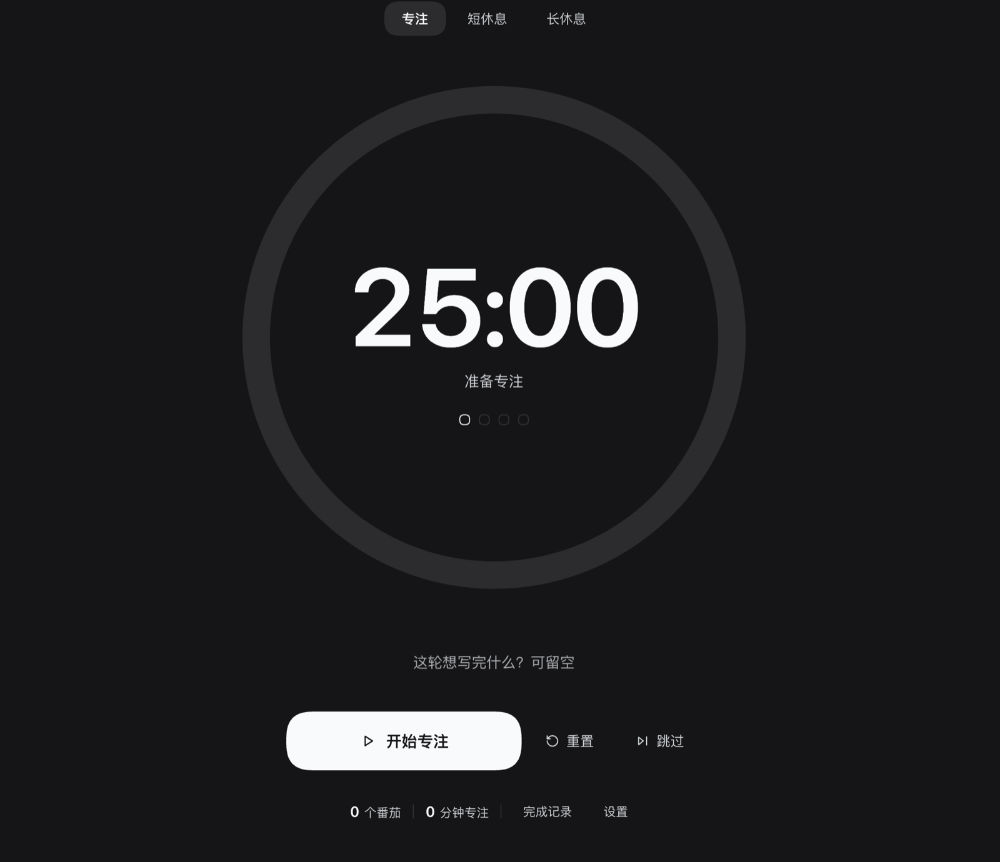

# dsh-pomodoro

[English](README.md) · 简体中文


> DSH 侧栏里的沉浸式番茄钟——专注 / 短休息 / 长休息三种模式，带「本轮目标」、今日统计和完成记录；切到别的面板，倒计时照样走。



面板本身就是计时器：一个巨大的进度环 + 大号倒计时，模式、目标和按钮都压低到次要层级。切到对话或其他面板不会暂停倒计时；在别处结束时，页面浮层会提示你，还会响一声（可关）。

## 功能

- **侧栏入口。** 注册一个 `sidebar.panellist` 行（`pomodoro`，order `21`）：装了 [dsh-book](https://github.com/ChenYichener/dsh-book) 时紧挨「写作」下面，否则跟在 shell 自己的入口后面。计时中图标右下角会亮一个绿色小点。
- **沉浸式页面。** 没有卡片、没有边框：一个大进度环（最大 560 px）、112 px 的等宽数字倒计时、三个安静的模式 tab、一个目标输入框和一组按钮；其余内容收进两个可展开的折叠面板。
- **三种模式。** 专注 / 短休息 / 长休息，默认 25 / 5 / 15 分钟；每完成 *N* 个番茄（默认 4）进入一次长休息。所有时长和 *N* 都能在「设置」里改。
- **本轮目标。** 一行最多 120 字——「这轮想写完什么？」，会跟每个完成的番茄一起记进当天记录。
- **开始 / 暂停 / 继续 / 重置 / 跳过。** 主按钮文案跟随状态；重置恢复当前模式的完整时长；跳过是「专注 → 短休息」或「休息 → 专注」。
- **今日统计。** 底部一行显示今天的番茄数和专注分钟数；「完成记录」列出每条记录的时间 + 目标 + 时长，清空需要点两次确认。
- **切换面板不停表。** 倒计时归模块级 store 所有，不属于挂载的页面，所以切到对话或其他面板时继续走，重新打开面板时从 store 恢复。
- **全窗口完成提示。** 浮层注册在 `shell.overlay`，所以「番茄完成，休息 5 分钟」在任何面板都看得到，显示 6 秒，并伴随一段柔和的双音提示（可关）。
- **持久化与跨天。** 设置、当天记录和正在进行的倒计时都存进 `localStorage`；页面关闭期间到点的番茄会在下次打开时完成结算，每日统计在本地零点自动翻篇。
- **主题与本地化。** 所有颜色走宿主 `--dsw-alias-*` 主题 token（深浅色自动适配），中英文文案通过 Client locale 服务注册。

## 安装

> 前置条件：[DeepSeek Harness](https://github.com/deepseek-ai/deepseek-harness)（`dsh`）带 Web UI，运行机器上 Node.js >= 20。

### 从 GitHub 安装（推荐）

```bash
dsh plugin --profile <profile> add github:ChenYichener/dsh-pomodoro
```

### 从本地 clone 安装

```bash
git clone https://github.com/ChenYichener/dsh-pomodoro.git
dsh plugin --profile <profile> add /path/to/dsh-pomodoro
```

### DSH 桌面端

在 App 的**插件管理**页从本地目录安装。本插件是普通的 profile bundle，`dsh` 重启和升级后都还在。

安装完重启 `dsh web`（或刷新 DSH 窗口），侧栏就会出现「番茄钟」。默认 profile 通常是 `web`（也就是 `dsh web` 用的那个）；不确定就跑 `dsh plugin --profile web list`。

### 环境要求

| 要求 | 取值 |
| --- | --- |
| DSH | 在 `0.2.2-rc.1` 上验证；需要 Web UI 及其 Client 插件 API |
| Node.js | `>= 20` |
| 运行时依赖 | 无 |
| 构建步骤 | 无——纯 ES module，由 DSH 的模块加载器直接加载 |

## 使用

点侧栏的**番茄钟**入口，shell 会选中 `main.pomodoro`，即整页计时器。

| 操作 | 怎么做 | 行为 |
| --- | --- | --- |
| 开始 | 主按钮（`开始专注` / `开始休息`） | 启动或继续当前模式的倒计时 |
| 暂停 / 继续 | 同一个主按钮（`暂停` / `继续`） | 暂停冻结剩余时间，继续从该时间接着走 |
| 重置 | ⟲ 按钮 | 停止计时并恢复当前模式的完整时长；今日统计不受影响 |
| 跳过 | ⏭ 按钮 | 专注 → 短休息，或短/长休息 → 专注。跳过掉的专注**不计**入番茄数 |
| 选模式 | 进度环上方的三个 tab | 停止计时并载入该模式的完整时长 |
| 写目标 | 进度环下方的输入框 | 与下一个完成的番茄一起保存；之后会一直保留，直到你手动改 |
| 改设置 | 底部 →「设置」 | 每项一个 stepper；修改当前空闲模式的时长会立刻更新倒计时 |
| 看记录 | 底部 →「完成记录」 | 今天的记录，最新在前：时间、目标（或「专注写作」）、分钟数 |
| 清空今天 | 「完成记录」→「清空」→ 再确认 | 清掉今天的番茄数、专注时长和记录，同时把本轮进度归零 |

没有全局快捷键——这个页面刻意做成纯点击、安静的形态。用其他面板时倒计时继续走，侧栏图标上的绿色小点表示正在计时。

## 设置

设置存在底部折叠面板里，并和其他状态一起持久化。

| 设置项 | 默认值 | 范围 | 步进 |
| --- | --- | --- | --- |
| 专注时长 | 25 分钟 | 5–90 分钟 | 5 分钟 |
| 短休息 | 5 分钟 | 1–30 分钟 | 1 分钟 |
| 长休息 | 15 分钟 | 5–60 分钟 | 5 分钟 |
| 长休息间隔 | 每 4 个番茄 | 2–8 个番茄 | 1 |
| 完成提示音 | 开 | 开 / 关 | — |

如果该模式正处于空闲状态，改时长会立刻更新可见的倒计时；改长休息间隔会把当前的本轮进度收敛到新间隔内。

## 实现说明

- **侧栏行。** Client 注册 `sidebar.panellist`，id 为 `pomodoro`，`order: 21`，`label` 绑定 locale。按钮由 shell 渲染，点击时选中 `main.pomodoro`；图标组件订阅 `snapshot.running`，计时中加一个角标。
- **主面板。** 同一个 Client 注册 key 为 `pomodoro` 的 `main` slot。页面是普通 React 组件，通过 `useSyncExternalStore` 读 store。
- **计时 store。** `createPomodoroStore()` 在 `apply()` 里创建一次，位于 React 之外。它持有状态对象、在每次变更时持久化可持久部分，并通知订阅者。计时不是组件状态，所以页面卸载（切换面板）永远不会停表。
- **时钟。** 计时中每 250 ms 刷新一次 `now`；剩余时间由绝对的 `endsAt` 时间戳推导，所以即使后台标签页被节流，倒计时也是准的。另一个 30 s 的 interval 负责在本地日期变化时把今日统计翻篇。
- **阶段切换。** 专注模式下 `now >= endsAt` 时结算这一轮（`today.count + 1`、`focusMs += 专注时长`、在最前面插一条记录，最多保留 50 条），本轮进度 +1。达到设置的 *N* 就进长休息，否则进短休息。休息结束后回到专注；长休息结束后把本轮进度归零。只有**完成**的专注会增加进度——跳过不算。
- **完成提示。** store 推一个临时 `notice` 对象，`shell.overlay` 把它渲染成 `role="status"` 的浮层，持续 6 秒。提示音是第一次点「开始」时用 WebAudio 创建的两个正弦短音，此时浏览器的用户手势要求已满足。
- **样式。** 一个 `<style data-plugin="dsh-pomodoro">` 元素由插件 fiber 持有；所有颜色引用 `--dsw-alias-*` token，所以页面跟随宿主的深浅色主题。
- **本地化。** 两套词典注册在 `dsh-pomodoro` locale 命名空间下；`useTranslate` 在 locale revision 变化时重渲染，服务不可用时回退到内置中文表。

## 数据与隐私

所有数据都留在浏览器里。没有网络请求、没有 Host 路由、没有 Host 状态、没有遥测。

状态存在 `localStorage` 的 `dsh-pomodoro/state/v1` 下：

```json
{
  "version": 1,
  "mode": "focus",
  "running": false,
  "endsAt": null,
  "remainingMs": 1500000,
  "cycle": 2,
  "goal": "把第 3 节开头改顺",
  "today": {
    "date": "2026-11-03",
    "count": 2,
    "focusMs": 3000000,
    "log": [
      { "at": 1762137600000, "minutes": 25, "goal": "把第 3 节开头改顺" }
    ]
  },
  "settings": { "focus": 25, "short": 5, "long": 15, "cycle": 4, "sound": true }
}
```

- `endsAt` 只在运行中写入；`now` 和临时的 `notice` 从不持久化。
- `today` 对应当地日历日；加载时和每次跨天检查时，其他日期的数据都会被丢弃。
- 清空浏览器的站点数据会一并清掉计时器、设置和记录——别处没有备份。

## 开发

没有构建步骤。`index.js` 和 `client.js` 都是纯 ES module；`client.js` 通过 `window.__ModuleLoader__` 注册自己，`react` 从宿主的模块表里解析。

```bash
node --check index.js
node --check client.js
```

这个插件目前没有自动化测试。手工验证：装进一个临时 profile，重启 `dsh web`，检查侧栏行、切换面板后倒计时是否继续、完成一轮的浮层、今日统计/记录，以及刷新页面后状态能否恢复。

## 项目结构

```text
dsh-pomodoro/
├── README.md                 # 英文（默认）
├── README.zh.md              # 简体中文
├── LICENSE                   # MIT
├── .gitignore
├── package.json              # bundle patch + dsh.client 声明
├── cordis.patch.yml          # 插入 dsh-pomodoro 插件行
├── index.js                  # Host 半边：空实现
├── client.js                 # Client 半边：store、slots、页面、浮层
├── locale/                   # 插件管理页展示的标题与描述（en, zh）
│   ├── en.json
│   └── zh.json
├── icon.svg                  # 插件图标
└── docs/
    └── screenshot.png        # 面板整页截图
```

## FAQ / 疑难排查

| 症状 | 处理 |
| --- | --- |
| 切到别的面板后计时还在走 | 预期行为：倒计时归模块级 store 所有，不属于页面。侧栏图标的角标表示它还在跑。 |
| 侧栏没有出现入口 | 重启 `dsh web` / 刷新窗口，并确认插件装在当前 profile 里。 |
| 入口不在「写作」正下方 | 这个位置是为 [dsh-book](https://github.com/ChenYichener/dsh-book)（order 20）调的；没装它时 order 21 就跟在 shell 其他入口后面。 |
| 到点没有提示音 | 检查「设置」里的**完成提示音**开关、系统音量和勿扰模式。第一次「开始」必须是真实点击——按钮本身就会触发。 |
| 设置或今天的记录没了 | 浏览器禁用了 `localStorage`（隐私模式 / 站点数据被清）或 profile 存储被重置。当次会话计时仍可用，但不会持久化。 |
| 一直等不到长休息 | 只有**完成**的专注会增加进度，重置和跳过都不算；再检查「长休息间隔」设置。 |
| DSH 是英文但页面显示中文 | 内置兜底表是中文；确认 DSH 的 locale 服务可用（安装后刷新一次页面）。 |
| 计时中途关掉了 DSH | 绝对的 `endsAt` 已持久化：下次打开时到点的番茄会被完成并计入；还没到点的会正确续上。 |
| 过了零点今天的数字清零 | 设计如此：统计和记录按本地日历日划分，完成的番茄不跨天累计。 |

## 兼容性

- **平台：** DSH 桌面端支持的平台（macOS、Windows、Linux）都可以；计时器是纯浏览器代码，在普通浏览器里打开 `dsh web` 也能用。
- **页面存活：** 页面必须活着，倒计时才会走、浮层才会出现。因为存的是绝对结束时间，页面关闭期间过期的番茄会在下次打开时结算。
- **DSH 插件 API：** 插件使用了 `sidebar.panellist`、`main`、`shell.overlay` 三个 slot 以及 `--dsw-alias-*` 主题 token。这些是 DSH Web UI 的内部结构：未来版本若改名，需要更新插件。
- **版本间不做数据迁移：** 存储 key 带版本（`/state/v1`）；无法读取或非法的快照会退化为默认值，而不是抛错。

## 相关 DSH 插件

| 插件 | 用途 |
| --- | --- |
| [dsh-book](https://github.com/ChenYichener/dsh-book) | Markdown 草稿库 + 面向小红书 / 公众号 / 通用文案的 AI 写作工作台 |
| [dsh-notify](https://github.com/ChenYichener/dsh-notify) | 会话在后台跑完时弹系统原生通知 |
| [dsh-pomodoro](https://github.com/ChenYichener/dsh-pomodoro) | 侧栏里的沉浸式番茄钟 |
| [dsh-translate](https://github.com/ChenYichener/dsh-translate) | 中英翻译工作台，带常驻 AI 助教和神经朗读 |
| [dsh-nce](https://github.com/ChenYichener/dsh-nce) | 新概念英语第一册学习面板（课文、间隔重复闪卡、错题本） |

## 许可证

[MIT](LICENSE) © 2026 chenyichen
